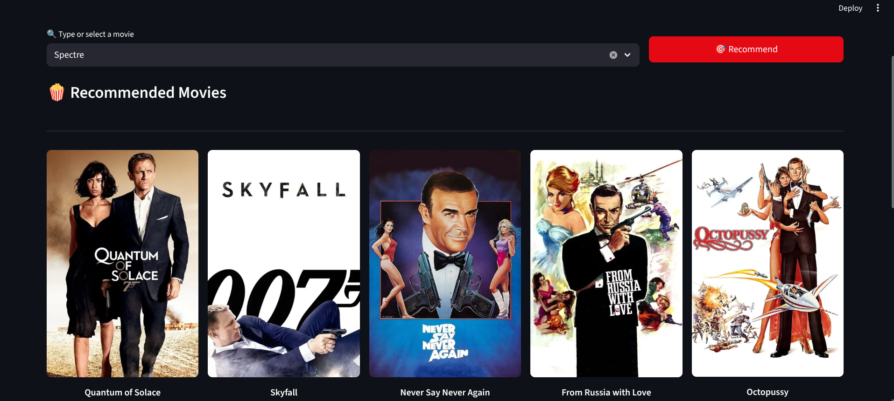

# 🎬 Movie Recommendation System

A content-based movie recommendation system that suggests similar movies based on genres, keywords, cast, crew, and overview. Built with Python, Scikit-learn, and Streamlit.



## 🚀 Features

- **Content-Based Filtering** — Recommends movies based on similarity of content (genres, keywords, cast, crew, overview)
- **Cosine Similarity** — Uses cosine similarity on bag-of-words vectors to find the most similar movies
- **Movie Posters** — Fetches real movie posters from TMDB API
- **Interactive Web App** — Built with Streamlit for a clean, user-friendly experience
- **4800+ Movies** — Trained on the TMDB 5000 Movies dataset

## 🛠️ Tech Stack

| Technology | Purpose |
|------------|---------|
| Python | Core programming language |
| Pandas & NumPy | Data manipulation |
| Scikit-learn | CountVectorizer & Cosine Similarity |
| NLTK | Text preprocessing (Porter Stemmer) |
| Streamlit | Web interface |
| TMDB API | Movie posters & details |
| Pickle | Model serialization |

## 📁 Project Structure

```
Movie_Recommendation_System/
├── app.py                   # Streamlit web application
├── movie.ipynb              # Jupyter notebook (EDA + model building)
├── movies_dict.pkl          # Serialized movie data
├── similarity.pkl           # Serialized similarity matrix
├── interface.png            # App screenshot
├── tmdb_5000_movies.csv     # Movies dataset
├── tmdb_5000_credits.csv    # Credits dataset
└── README.md
```

## ⚙️ How It Works

1. **Data Preprocessing** — Merge movies and credits datasets, extract genres, keywords, top 3 cast members, and director
2. **Feature Engineering** — Combine all features into a single `tags` column
3. **Text Processing** — Apply stemming (Porter Stemmer) to normalize words
4. **Vectorization** — Convert text to numerical vectors using CountVectorizer (5000 features)
5. **Similarity Calculation** — Compute cosine similarity between all movie vectors
6. **Recommendation** — For a selected movie, return the top 5 most similar movies

## 🏃 How to Run

### 1. Clone the repository
```bash
git clone https://github.com/ZahidMiana/Movie_Recommendation_System.git
cd Movie_Recommendation_System
```

### 2. Install dependencies
```bash
pip install streamlit pandas numpy scikit-learn nltk requests
```

### 3. Run the app
```bash
streamlit run app.py
```

The app will open at **http://localhost:8501**

## 📊 Dataset

- **Source:** [TMDB 5000 Movie Dataset](https://www.kaggle.com/datasets/tmdb/tmdb-movie-metadata)
- **Movies:** 4806 movies after preprocessing
- **Features used:** Genres, Keywords, Cast (top 3), Director, Overview

## 🤝 Contributing

Contributions are welcome! Feel free to open an issue or submit a pull request.

## 📝 License

This project is open source and available under the [MIT License](LICENSE).

---

⭐ If you found this project helpful, give it a star!
